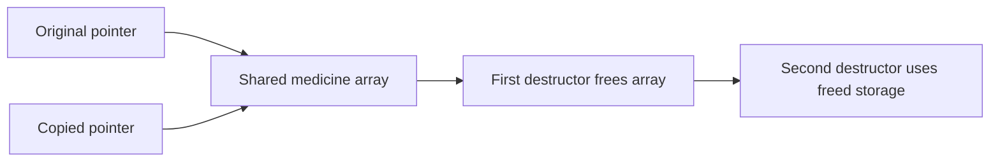
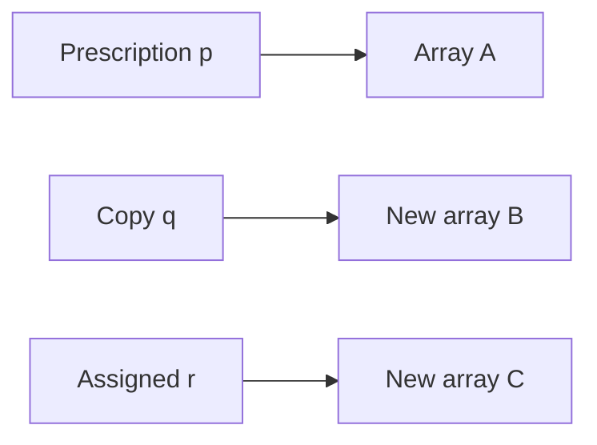
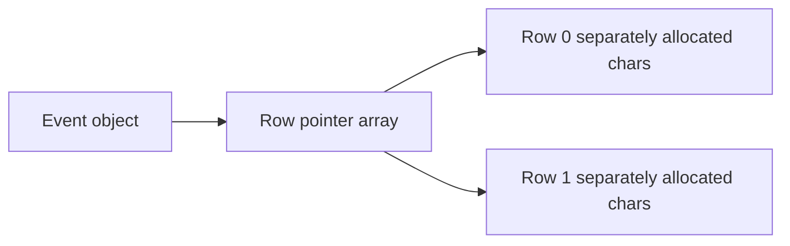
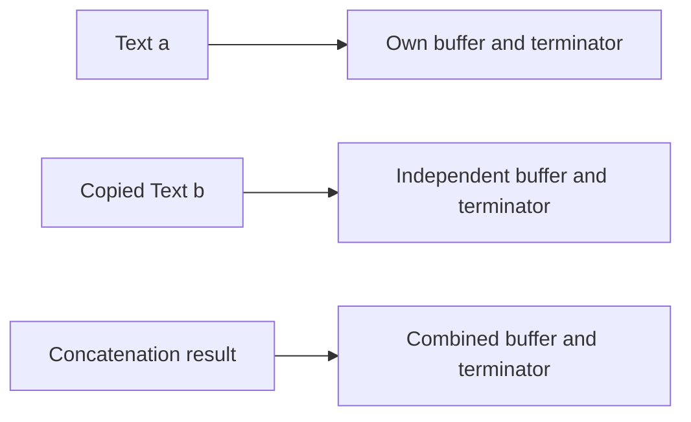
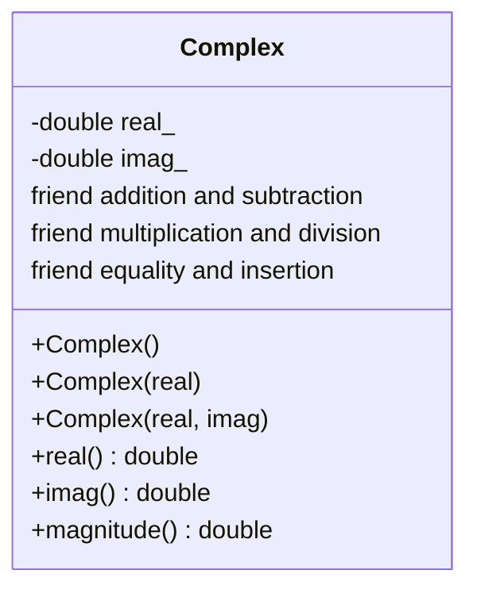

# Assignment 3 CO3 Report

**Student:** S Vinoth Kumar  
**Register number:** 192471006  
**Repository:** https://github.com/vinoththecool7-netizen/DSA01-192471006-Assignment3

This report evaluates constructors, destructors, resource ownership and meaningful overloaded operators through Q1–Q7. The corrected designs use validated construction, explicit ownership, exception-safe copying and well-defined value semantics. It includes actual assistant-run experiments and clearly labelled expected failures.

Each task folder contains the complete source and machine-readable manifests. The exact compiler was Apple clang 21.0.0 on arm64 macOS; normal flags are -std=c++17 -Wall -Wextra -Wpedantic -Iinclude -O0, with separate optimisation and sanitizer variants. The original supplied specification is preserved unchanged.

## Contents

- Q1 Constructors and constructor overloading
- Q2 Prescription copying and the Rule of Three
- Q3 Dynamic seat maps and destructors
- Q4 Money arithmetic and stream operators
- Q5 Increment comparison and subscript operators
- Q6 Text ownership and the rules of overloading
- Q7 Complex impedance design from first principles

---

# Q1 Constructors and constructor overloading

## Design and implementation

Book keeps its title, author and copy count private. The default constructor delegates to the full constructor with empty strings and zero copies; the explicit title-only overload delegates with author Unknown and one copy, an assumption for a donated book. The full constructor initialises every member in a member initializer list and rejects a negative count with invalid_argument. A throwing constructor does not leave a usable invalid Book. Zero copies is a valid empty record.

Object states after construction:

| Object | Title | Author | Copies |
|---|---|---|---|
| empty | empty string | empty string | 0 |
| donated | Donated Atlas | Unknown | 1 |
| full | C++ Primer | Lippman | 3 |

The compiler implicitly declares a default constructor when no user-declared constructor or constructor template exists. Declaring the title constructor therefore prevents an implicit no-argument constructor; the separate no_default experiment attempts Book books[3] and must fail. An implicitly declared/defaulted constructor can itself be deleted if a member or base cannot be default-constructed.

Initializer lists directly construct members, support const/reference members, and avoid default construction followed by assignment. Bases are initialised first, then data members in declaration order, regardless of list order. The reorder experiment deliberately lists second before first without reading an uninitialised value; the actual warning and printed 1 2 are saved.

## Explicit conversion experiment

A single-argument constructor should normally be explicit when automatic conversion would hide an object-creation decision. accept(std::string{"Title"}) works with the implicit wrapper but fails with explicit. Both source variants and actual compiler outcomes are retained. Direct construction Book{"Title"} still works.

## Alternative and complexity

A single constructor could use Book(std::string title="", std::string author="", int copies=0) with one validation point. Delegation also gives one validation point; it is incorrect to claim the overload design necessarily validates in more places. Default arguments would give a title-only donated record zero copies unless that business rule were changed; overloads express the distinct situations clearly.

With fixed-size fields or fixed-length strings both designs have O(1) object-creation overhead and object footprint. For arbitrary title/author lengths T and A, copying strings actually costs O(T+A) time and owned character storage in either design; moving supplied strings can avoid those copies. The assignment's O(1) statement is therefore a fixed-size abstraction, not a universal string-copy guarantee.

## Evidence

Run python3 scripts/validate.py --task Task01, optionally adding --sanitize. The evidence directories contain stdout, stderr, exact compilation commands, return codes and source digests. Negative-copy, explicit-conversion and missing-default checks are real experiments; the intentionally invalid sources use .cpp.txt so they do not break ordinary source builds.


## Actual ordinary execution evidence

**book_O0.stdout.txt**

```text
Book{title='', author='', copies=0}
Book{title='Donated Atlas', author='Unknown', copies=1}
Book{title='C++ Primer', author='Lippman', copies=3}
empty initialised, PASS
donation has one copy, PASS
full record, PASS
negative copies rejected, PASS
Checks: 4 passed, 0 failed
```

**implicit.ok_O0.stdout.txt**

```text

```

**reorder.warn_O0.stdout.txt**

```text
1 2
```

**explicit.fail_O0.compile.txt**

```text
$ g++ -std=c++17 -Wall -Wextra -Wpedantic -Iinclude -O0 -x c++ Task01/explicit.fail.cpp.txt -o build/Task01_explicit.fail_O0_normal
Task01/explicit.fail.cpp.txt:4:12: error: no matching function for call to 'accept'
    4 | int main(){accept(std::string{"Title"});}
      |            ^~~~~~
Task01/explicit.fail.cpp.txt:3:6: note: candidate function not viable: no known conversion from 'std::string' (aka 'basic_string<char>') to 'Book' for 1st argument
    3 | void accept(Book){}
      |      ^      ~~~~
1 error generated.

exit_code=1
```

**no_default.fail_O0.compile.txt**

```text
$ g++ -std=c++17 -Wall -Wextra -Wpedantic -Iinclude -O0 -x c++ Task01/no_default.fail.cpp.txt -o build/Task01_no_default.fail_O0_normal
Task01/no_default.fail.cpp.txt:3:17: error: no matching constructor for initialization of 'Book[3]'
    3 | int main(){Book books[3];}
      |                 ^
Task01/no_default.fail.cpp.txt:2:43: note: candidate constructor not viable: requires single argument 't', but no arguments were provided
    2 | struct Book { std::string title; explicit Book(std::string t):title{t}{} };
      |                                           ^    ~~~~~~~~~~~~~
Task01/no_default.fail.cpp.txt:2:8: note: candidate constructor (the implicit copy constructor) not viable: requires 1 argument, but 0 were provided
    2 | struct Book { std::string title; explicit Book(std::string t):title{t}{} };
      |        ^~~~
Task01/no_default.fail.cpp.txt:2:8: note: candidate constructor (the implicit move constructor) not viable: requires 1 argument, but 0 were provided
    2 | struct Book { std::string title; explicit Book(std::string t):title{t}{} };
      |        ^~~~
1 error generated.

exit_code=1
```

**reorder.warn_O0.compile.txt**

```text
$ g++ -std=c++17 -Wall -Wextra -Wpedantic -Iinclude -O0 -x c++ Task01/reorder.warn.cpp.txt -o build/Task01_reorder.warn_O0_normal
Task01/reorder.warn.cpp.txt:4:15: warning: field 'second' will be initialized after field 'first' [-Wreorder-ctor]
    4 |  WrongOrder():second{2},first{1}{} // Actual order is first, second; no uninitialised read.
      |               ^~~~~~~~~ ~~~~~~~~
      |               first{1}  second{2}
1 warning generated.

exit_code=0
```


---

# Q2 Prescription copying and the Rule of Three

## Design and memory diagrams

The unsafe version owns a dynamically allocated string array but has no copy constructor. Compiler-generated copying aliases the pointer. Editing q changes p. When q destroys the shared array, p becomes dangling. The actual ASan diagnostic is heap-use-after-free inside the second destructor while it destroys already-freed string objects. Double ownership is the cause; the saved error is not falsely labelled a reported double-free.



The corrected memory layout is independent:



The corrected copy constructor allocates a fresh array; assignment guards self-assignment, constructs a deep temporary and swaps ownership; the destructor uses delete[]. This is the Rule of Three: destructor, copy constructor and copy assignment must agree on resource ownership. The delegating copy constructor also ensures cleanup if a string assignment throws after the target constructor completes. The hardened class checks counts/indices and supports zero medicines.

complete.cpp preserves the supplied skeleton outside the three TODO replacements, including its original unchecked constructor/set/get. Exception cleanup is included inside the TODO bodies. Its output exactly matches the supplied expected line. without_copy_broken.cpp removes that completed copy constructor while retaining the destructor and copy assignment, and is run separately under ASan as required.

## Copy situations and experiments

Copy construction occurs when initialising from another object, passing a named object by value, or returning an existing object by value when a copy is selected. Return-value copies can be elided; C++17 prvalues have mandatory elision in relevant cases, so returning a value does not guarantee an observable copy call.

Instrumentation observed one copy for a by-value parameter and zero for const reference. Self-assignment, independent edits, assignment independence, negative count, zero size and invalid indices are checked. Five full copies of 10, 1,000 and 100,000 medicines are timed, including allocation/destruction; raw nanosecond totals and checksums are in evidence/normal/main_O0.stdout.txt. These are single local measurements, not universal timings.

## Alternative and evaluation

vector.cpp implements struct Prescription { vector<string> medicines; }; compiler-generated vector/string copies already own independent values, demonstrating the Rule of Zero. Default copying is suitable for value members or intentionally non-owning references, but an owning raw pointer needs explicit ownership rules or a standard RAII container.

For n bounded-length names, both deep-copy solutions require O(n) time and O(n) new storage; more precisely total character count S gives O(n+S). Shallow pointer copying is O(1) time/space but is incorrect for exclusive owning values. Const-reference passing is O(1) and avoids ownership duplication.

Both broken programs are actually rejected with heap-use-after-free. Corrected main, completed skeleton and vector programs pass without address/undefined-behaviour diagnostics. Run python3 scripts/validate.py --task Task02, then repeat with --sanitize. Raw stderr, stdout, exit codes and exact compile commands are retained. Local ASan does not provide leak detection; see Q3.


## Actual ordinary execution evidence

**complete_O0.stdout.txt**

```text
Ibuprofen ORS | Paracetamol Cetirizine | Paracetamol ORS
```

**main_O0.stdout.txt**

```text
copy independent, PASS
assignment independent, PASS
self assignment, PASS
value parameter data, PASS
by value copies=1
one copy by value, PASS
reference parameter data, PASS
const reference copies=0
zero copies by reference, PASS
negative count, PASS
negative index, PASS
empty prescription, PASS
copy medicines=10 repetitions=5 total_ns=1917 checksum=50
copy medicines=1000 repetitions=5 total_ns=127542 checksum=60
copy medicines=100000 repetitions=5 total_ns=13121750 checksum=70
Checks: 10 passed, 0 failed
```

**vector_O0.stdout.txt**

```text
Rule of Zero independent copy, PASS
Checks: 1 passed, 0 failed
```


## Actual expected sanitizer rejection

**shallow_broken_O0.stderr.txt**

```text
=================================================================
==6109==ERROR: AddressSanitizer: heap-use-after-free on address 0x606000000688 at pc 0x000104229814 bp 0x00016bbd62f0 sp 0x00016bbd62e8
READ of size 8 at 0x606000000688 thread T0
==6109==WARNING: external symbolizer didn't start up correctly!
==6109==WARNING: Can't read from symbolizer at fd 3
==6109==WARNING: atos failed to symbolize address "0x104229810"
==6109==WARNING: Can't read from symbolizer at fd 3
==6109==WARNING: atos failed to symbolize address "0x104229520"
==6109==WARNING: Can't read from symbolizer at fd 3
==6109==WARNING: atos failed to symbolize address "0x104228bdc"
==6109==WARNING: Can't read from symbolizer at fd 3
==6109==WARNING: atos failed to symbolize address "0x1872d0d78"
    #0 0x000104229810 in Prescription::~Prescription()+0xd8 (/Users/vinothkumar/Documents/Codex/2026-10-19/referenced-chatgpt-conversation-this-is-an/assignment3/build/Task02_shallow_broken_O0_san:arm64+0x100001810)
    #1 0x000104229520 in Prescription::~Prescription()+0x50 (/Users/vinothkumar/Documents/Codex/2026-10-19/referenced-chatgpt-conversation-this-is-an/assignment3/build/Task02_shallow_broken_O0_san:arm64+0x100001520)
    #2 0x000104228bdc in main+0x2fc (/Users/vinothkumar/Documents/Codex/2026-10-19/referenced-chatgpt-conversation-this-is-an/assignment3/build/Task02_shallow_broken_O0_san:arm64+0x100000bdc)
    #3 0x0001872d0d78 in start+0x19f8 (/usr/lib/dyld:arm64e+0x31d78)

0x606000000688 is located 8 bytes inside of 64-byte region [0x606000000680,0x6060000006c0)
freed by thread T0 here:
==6109==WARNING: Can't read from symbolizer at fd 3
==6109==WARNING: atos failed to symbolize address "0x104c08644"
==6109==WARNING: Can't read from symbolizer at fd 3
==6109==WARNING: atos failed to symbolize address "0x10422986c"
==6109==WARNING: Can't read from symbolizer at fd 3
==6109==WARNING: atos failed to symbolize address "0x104229520"
==6109==WARNING: Can't read from symbolizer at fd 3
==6109==WARNING: atos failed to symbolize address "0x104228bc0"
==6109==WARNING: Can't read from symbolizer at fd 3
==6109==WARNING: atos failed to symbolize address "0x1872d0d78"
    #0 0x000104c08644 in _ZdaPv+0x74 (/Applications/Xcode.app/Contents/Developer/Toolchains/XcodeDefault.xctoolchain/usr/lib/clang/21/lib/darwin/libclang_rt.asan_osx_dynamic.dylib:arm64e+0x50644)
    #1 0x00010422986c in Prescription::~Prescription()+0x134 (/Users/vinothkumar/Documents/Codex/2026-10-19/referenced-chatgpt-conversation-this-is-an/assignment3/build/Task02_shallow_broken_O0_san:arm64+0x10000186c)
    #2 0x000104229520 in Prescription::~Prescription()+0x50 (/Users/vinothkumar/Documents/Codex/2026-10-19/referenced-chatgpt-conversation-this-is-an/assignment3/build/Task02_shallow_broken_O0_san:arm64+0x100001520)
    #3 0x000104228bc0 in main+0x2e0 (/Users/vinothkumar/Documents/Codex/2026-10-19/referenced-chatgpt-conversation-this-is-an/assignment3/build/Task02_shallow_broken_O0_san:arm64+0x100000bc0)
    #4 0x0001872d0d78 in start+0x19f8 (/usr/lib/dyld:arm64e+0x31d78)

previously allocated by thread T0 here:
==6109==WARNING: Can't read from symbolizer at fd 3
==6109==WARNING: atos failed to symbolize address "0x104c08268"
==6109==WARNING: Can't read from symbolizer at fd 3
==6109==WARNING: atos failed to symbolize address "0x1042295a0"
==6109==WARNING: Can't read from symbolizer at fd 3
==6109==WARNING: atos failed to symbolize address "0x104228e24"
==6109==WARNING: Can't read from symbolizer at fd 3
==6109==WARNING: atos failed to symbolize address "0x104228a48"
==6109==WARNING: Can't read from symbolizer at fd 3
==6109==WARNING: atos failed to symbolize address "0x1872d0d78"
    #0 0x000104c08268 in _Znam+0x74 (/Applications/Xcode.app/Contents/Developer/Toolchains/XcodeDefault.xctoolchain/usr/lib/clang/21/lib/darwin/libclang_rt.asan_osx_dynamic.dylib:arm64e+0x50268)
    #1 0x0001042295a0 in Prescription::Prescription()+0x6c (/Users/vinothkumar/Documents/Codex/2026-10-19/referenced-chatgpt-conversation-this-is-an/assignment3/build/Task02_shallow_broken_O0_san:arm64+0x1000015a0)
    #2 0x000104228e24 in Prescription::Prescription()+0x50 (/Users/vinothkumar/Documents/Codex/2026-10-19/referenced-chatgpt-conversation-this-is-an/assignment3/build/Task02_shallow_broken_O0_san:arm64+0x100000e24)
    #3 0x000104228a48 in main+0x168 (/Users/vinothkumar/Documents/Codex/2026-10-19/referenced-chatgpt-conversation-this-is-an/assignment3/build/Task02_shallow_broken_O0_san:arm64+0x100000a48)
    #4 0x0001872d0d78 in start+0x19f8 (/usr/lib/dyld:arm64e+0x31d78)

==6109==WARNING: Can't read from symbolizer at fd 3
==6109==WARNING: atos failed to symbolize address "0x104229810"
SUMMARY: AddressSanitizer: heap-use-after-free (/Users/vinothkumar/Documents/Codex/2026-10-19/referenced-chatgpt-conversation-this-is-an/assignment3/build/Task02_shallow_broken_O0_san:arm64+0x100001810) in Prescription::~Prescription()+0xd8
Shadow bytes around the buggy address:
  0x606000000400: fd fd fd fa fa fa fa fa fd fd fd fd fd fd fd fd
  0x606000000480: fa fa fa fa fd fd fd fd fd fd fd fd fa fa fa fa
  0x606000000500: 00 00 00 00 00 00 00 00 fa fa fa fa 00 00 00 00
  0x606000000580: 00 00 02 fa fa fa fa fa 00 00 00 00 00 00 00 00
  0x606000000600: fa fa fa fa 00 00 00 00 00 00 06 fa fa fa fa fa
=>0x606000000680: fd[fd]fd fd fd fd fd fd fa fa fa fa fa fa fa fa
  0x606000000700: fa fa fa fa fa fa fa fa fa fa fa fa fa fa fa fa
  0x606000000780: fa fa fa fa fa fa fa fa fa fa fa fa fa fa fa fa
  0x606000000800: fa fa fa fa fa fa fa fa fa fa fa fa fa fa fa fa
  0x606000000880: fa fa fa fa fa fa fa fa fa fa fa fa fa fa fa fa
  0x606000000900: fa fa fa fa fa fa fa fa fa fa fa fa fa fa fa fa
Shadow byte legend (one shadow byte represents 8 application bytes):
  Addressable:           00
  Partially addressable: 01 02 03 04 05 06 07 
  Heap left redzone:       fa
  Freed heap region:       fd
  Stack left redzone:      f1
  Stack mid redzone:       f2
  Stack right redzone:     f3
  Stack after return:      f5
  Stack use after scope:   f8
  Global redzone:          f9
  Global init order:       f6
  Poisoned by user:        f7
  Container overflow:      fc
  Array cookie:            ac
  Intra object redzone:    bb
  ASan internal:           fe
  Left alloca redzone:     ca
  Right alloca redzone:    cb
==6109==ABORTING
```

## Actual expected sanitizer rejection

**without_copy_broken_O0.stderr.txt**

```text
=================================================================
==6122==ERROR: AddressSanitizer: heap-use-after-free on address 0x606000000688 at pc 0x0001028ef69c bp 0x00016d511f90 sp 0x00016d511f88
READ of size 8 at 0x606000000688 thread T0
==6122==WARNING: external symbolizer didn't start up correctly!
==6122==WARNING: Can't read from symbolizer at fd 3
==6122==WARNING: atos failed to symbolize address "0x1028ef698"
==6122==WARNING: Can't read from symbolizer at fd 3
==6122==WARNING: atos failed to symbolize address "0x1028ee8a0"
==6122==WARNING: Can't read from symbolizer at fd 3
==6122==WARNING: atos failed to symbolize address "0x1028ed200"
==6122==WARNING: Can't read from symbolizer at fd 3
==6122==WARNING: atos failed to symbolize address "0x1872d0d78"
    #0 0x0001028ef698 in Prescription::~Prescription()+0xdc (/Users/vinothkumar/Documents/Codex/2026-10-19/referenced-chatgpt-conversation-this-is-an/assignment3/build/Task02_without_copy_broken_O0_san:arm64+0x100003698)
    #1 0x0001028ee8a0 in Prescription::~Prescription()+0x50 (/Users/vinothkumar/Documents/Codex/2026-10-19/referenced-chatgpt-conversation-this-is-an/assignment3/build/Task02_without_copy_broken_O0_san:arm64+0x1000028a0)
    #2 0x0001028ed200 in main+0x920 (/Users/vinothkumar/Documents/Codex/2026-10-19/referenced-chatgpt-conversation-this-is-an/assignment3/build/Task02_without_copy_broken_O0_san:arm64+0x100001200)
    #3 0x0001872d0d78 in start+0x19f8 (/usr/lib/dyld:arm64e+0x31d78)

0x606000000688 is located 8 bytes inside of 64-byte region [0x606000000680,0x6060000006c0)
freed by thread T0 here:
==6122==WARNING: Can't read from symbolizer at fd 3
==6122==WARNING: atos failed to symbolize address "0x1031bc644"
==6122==WARNING: Can't read from symbolizer at fd 3
==6122==WARNING: atos failed to symbolize address "0x1028ef6f4"
==6122==WARNING: Can't read from symbolizer at fd 3
==6122==WARNING: atos failed to symbolize address "0x1028ee8a0"
==6122==WARNING: Can't read from symbolizer at fd 3
==6122==WARNING: atos failed to symbolize address "0x1028ed1e8"
==6122==WARNING: Can't read from symbolizer at fd 3
==6122==WARNING: atos failed to symbolize address "0x1872d0d78"
    #0 0x0001031bc644 in _ZdaPv+0x74 (/Applications/Xcode.app/Contents/Developer/Toolchains/XcodeDefault.xctoolchain/usr/lib/clang/21/lib/darwin/libclang_rt.asan_osx_dynamic.dylib:arm64e+0x50644)
    #1 0x0001028ef6f4 in Prescription::~Prescription()+0x138 (/Users/vinothkumar/Documents/Codex/2026-10-19/referenced-chatgpt-conversation-this-is-an/assignment3/build/Task02_without_copy_broken_O0_san:arm64+0x1000036f4)
    #2 0x0001028ee8a0 in Prescription::~Prescription()+0x50 (/Users/vinothkumar/Documents/Codex/2026-10-19/referenced-chatgpt-conversation-this-is-an/assignment3/build/Task02_without_copy_broken_O0_san:arm64+0x1000028a0)
    #3 0x0001028ed1e8 in main+0x908 (/Users/vinothkumar/Documents/Codex/2026-10-19/referenced-chatgpt-conversation-this-is-an/assignment3/build/Task02_without_copy_broken_O0_san:arm64+0x1000011e8)
    #4 0x0001872d0d78 in start+0x19f8 (/usr/lib/dyld:arm64e+0x31d78)

previously allocated by thread T0 here:
==6122==WARNING: Can't read from symbolizer at fd 3
==6122==WARNING: atos failed to symbolize address "0x1031bc268"
==6122==WARNING: Can't read from symbolizer at fd 3
==6122==WARNING: atos failed to symbolize address "0x1028ee9bc"
==6122==WARNING: Can't read from symbolizer at fd 3
==6122==WARNING: atos failed to symbolize address "0x1028ed6f4"
==6122==WARNING: Can't read from symbolizer at fd 3
==6122==WARNING: atos failed to symbolize address "0x1028ecb04"
==6122==WARNING: Can't read from symbolizer at fd 3
==6122==WARNING: atos failed to symbolize address "0x1872d0d78"
    #0 0x0001031bc268 in _Znam+0x74 (/Applications/Xcode.app/Contents/Developer/Toolchains/XcodeDefault.xctoolchain/usr/lib/clang/21/lib/darwin/libclang_rt.asan_osx_dynamic.dylib:arm64e+0x50268)
    #1 0x0001028ee9bc in Prescription::Prescription(int)+0x108 (/Users/vinothkumar/Documents/Codex/2026-10-19/referenced-chatgpt-conversation-this-is-an/assignment3/build/Task02_without_copy_broken_O0_san:arm64+0x1000029bc)
    #2 0x0001028ed6f4 in Prescription::Prescription(int)+0x58 (/Users/vinothkumar/Documents/Codex/2026-10-19/referenced-chatgpt-conversation-this-is-an/assignment3/build/Task02_without_copy_broken_O0_san:arm64+0x1000016f4)
    #3 0x0001028ecb04 in main+0x224 (/Users/vinothkumar/Documents/Codex/2026-10-19/referenced-chatgpt-conversation-this-is-an/assignment3/build/Task02_without_copy_broken_O0_san:arm64+0x100000b04)
    #4 0x0001872d0d78 in start+0x19f8 (/usr/lib/dyld:arm64e+0x31d78)

==6122==WARNING: Can't read from symbolizer at fd 3
==6122==WARNING: atos failed to symbolize address "0x1028ef698"
SUMMARY: AddressSanitizer: heap-use-after-free (/Users/vinothkumar/Documents/Codex/2026-10-19/referenced-chatgpt-conversation-this-is-an/assignment3/build/Task02_without_copy_broken_O0_san:arm64+0x100003698) in Prescription::~Prescription()+0xdc
Shadow bytes around the buggy address:
  0x606000000400: fd fd fd fa fa fa fa fa fd fd fd fd fd fd fd fd
  0x606000000480: fa fa fa fa fd fd fd fd fd fd fd fd fa fa fa fa
  0x606000000500: 00 00 00 00 00 00 00 00 fa fa fa fa 00 00 00 00
  0x606000000580: 00 00 02 fa fa fa fa fa 00 00 00 00 00 00 00 00
  0x606000000600: fa fa fa fa 00 00 00 00 00 00 06 fa fa fa fa fa
=>0x606000000680: fd[fd]fd fd fd fd fd fd fa fa fa fa fd fd fd fd
  0x606000000700: fd fd fd fd fa fa fa fa fa fa fa fa fa fa fa fa
  0x606000000780: fa fa fa fa fa fa fa fa fa fa fa fa fa fa fa fa
  0x606000000800: fa fa fa fa fa fa fa fa fa fa fa fa fa fa fa fa
  0x606000000880: fa fa fa fa fa fa fa fa fa fa fa fa fa fa fa fa
  0x606000000900: fa fa fa fa fa fa fa fa fa fa fa fa fa fa fa fa
Shadow byte legend (one shadow byte represents 8 application bytes):
  Addressable:           00
  Partially addressable: 01 02 03 04 05 06 07 
  Heap left redzone:       fa
  Freed heap region:       fd
  Stack left redzone:      f1
  Stack mid redzone:       f2
  Stack right redzone:     f3
  Stack after return:      f5
  Stack use after scope:   f8
  Global redzone:          f9
  Global init order:       f6
  Poisoned by user:        f7
  Container overflow:      fc
  Array cookie:            ac
  Intra object redzone:    bb
  ASan internal:           fe
  Left alloca redzone:     ca
  Right alloca redzone:    cb
==6122==ABORTING
```

---

# Q3 Dynamic seat maps and destructors

## Design and ownership

Event allocates a value-initialised array of row pointers with new[], then one char array per row. Constructor failure releases every row already allocated. The destructor deletes each row and the pointer array with delete[], prints the booked-seat count and updates a live-object counter. Copy operations are deleted to prevent accidental ownership duplication. Booking/cancellation validate both indices; duplicate booking and empty cancellation return false.



Stack objects are destroyed on scope exit in reverse construction order. In the experiment the explicit heap delete destroys heap before the block event is destroyed, and the outer stack event is last. A pointer's scope ending does not delete its pointee. In C++17 a destructor has no arguments/return type and cannot be overloaded; it is the class lifetime-ending cleanup operation. Mixing new[] with delete is undefined behaviour, not a reliable way of releasing an array.

## Measurements and experiments

| Rows x seats | Requested row and pointer bytes | Map allocations |
|---|---|---|
| 10 x 20 | 280 | 11 |
| 100 x 200 | 20,800 | 101 |
| 1,000 x 2,000 | 2,008,000 | 1,001 |

Measured sizes use sizeof(char)=1 and sizeof(char*)=8: rows*seats + rows*sizeof(char*). They exclude allocator bookkeeping, resident memory and the Event object's own storage. The code calculates and checks the values. Zero rows is valid with zero allocations; booking a seat in it throws. Negative dimensions, invalid indices and positive rows with zero seats are rejected.

missing_delete.cpp intentionally leaves one live Event and prints live events at exit=1. It was executed under ASan. However this platform does not support LeakSanitizer: -fsanitize=leak is rejected by the compiler, and detect_leaks=1 aborts with the actual message that detect_leaks is not supported on this platform. Both probe logs are retained under evidence/leak_probe. The ordinary ASan run therefore does not report this known leak. A separate successful Linux GitHub Actions run now supplies the missing detector evidence: LeakSanitizer detected the omitted delete, while the corrected Event program exited without leak or address findings. The original timestamped job log is retained as evidence/linux_ci_job.log and the verified run URL/commit are in CI_EVIDENCE.json. The local platform limitation remains documented rather than hidden.

The separate delete_mismatch_broken example is actually rejected by ASan with alloc-dealloc-mismatch when that check is enabled. The corrected Event code has no address/undefined-behaviour findings. RAII ties memory release to scope exit and exception unwinding. Prefer stack Event or unique_ptr<Event> so callers cannot forget deleting the Event object itself.

## Prediction

prediction.txt was committed before Logger was first run. Exact output is +A +B -B copyAc use -Ac +P -P end -A followed by a trailing space and no newline. B is destroyed at block end. Passing named a by value constructs Ac and destroys it after use. new constructs P, delete destroys P, end is printed, then outer A is destroyed. Prediction and execution match. This is assistant-authored, not personal student prediction evidence.

## Alternative and complexity

A flat char* data=new char[rows*seats]{} uses one nonempty allocation and index r*seats+s after dimension/index checks. vector<char> gives that contiguous layout with automatic cleanup. vector<vector<char>> is also RAII, but normally uses an outer allocation plus one allocation per nonempty row and adds per-row vector metadata. All have O(1) indexed access and O(rows*seats) payload/initialisation work. Row pointers add O(rows) storage; the raw destructor releases rows+1 allocations. Prefer flat vector storage in production; the raw version teaches explicit lifetime mechanics.

Run python3 scripts/validate.py --task Task03 and repeat with --sanitize. A successful process exit for the intentional missing-delete fixture is not evidence that its memory management is correct.


## Recorded pre execution prediction

```text
Assistant prediction recorded before execution. Not a personal student prediction.
Exact stdout has one trailing space and no newline:
+A +B -B copyAc use -Ac +P -P end -A
```

## Actual ordinary execution evidence

**logger_O0.stdout.txt**

```text
+A +B -B copyAc use -Ac +P -P end -A
```

**main_O0.stdout.txt**

```text
construct stack rows=2 seats=3
book, PASS
duplicate booking, PASS
construct block rows=1 seats=2
construct heap rows=1 seats=1
heap booking, PASS
destroy heap booked=1
destroy block booked=0
cancel, PASS
empty cancellation, PASS
invalid seat, PASS
destroy stack booked=0
all scoped events destroyed, PASS
construct measurement rows=10 seats=20
requested_bytes=280 allocations=11
payload formula, PASS
destroy measurement booked=0
construct measurement rows=100 seats=200
requested_bytes=20800 allocations=101
payload formula, PASS
destroy measurement booked=0
construct measurement rows=1000 seats=2000
requested_bytes=2008000 allocations=1001
payload formula, PASS
destroy measurement booked=0
construct zero rows=0 seats=0
zero row no allocations, PASS
empty booking, PASS
destroy zero booked=0
negative rows, PASS
Checks: 13 passed, 0 failed
```

**missing_delete_O0.stdout.txt**

```text
construct intentionally leaked rows=10 seats=20
live events at exit=1 (delete deliberately omitted)
```


## Actual expected sanitizer rejection

**delete_mismatch_broken_O0.stderr.txt**

```text
=================================================================
==6150==ERROR: AddressSanitizer: alloc-dealloc-mismatch (operator new [] vs operator delete) on 0x604000000850
==6150==WARNING: external symbolizer didn't start up correctly!
==6150==WARNING: Can't read from symbolizer at fd 3
==6150==WARNING: atos failed to symbolize address "0x105064558"
==6150==WARNING: Can't read from symbolizer at fd 3
==6150==WARNING: atos failed to symbolize address "0x10465479c"
==6150==WARNING: Can't read from symbolizer at fd 3
==6150==WARNING: atos failed to symbolize address "0x1872d0d78"
    #0 0x000105064558 in _ZdlPv+0x74 (/Applications/Xcode.app/Contents/Developer/Toolchains/XcodeDefault.xctoolchain/usr/lib/clang/21/lib/darwin/libclang_rt.asan_osx_dynamic.dylib:arm64e+0x50558)
    #1 0x00010465479c in main+0x9c (/Users/vinothkumar/Documents/Codex/2026-10-19/referenced-chatgpt-conversation-this-is-an/assignment3/build/Task03_delete_mismatch_broken_O0_san:arm64+0x10000079c)
    #2 0x0001872d0d78 in start+0x19f8 (/usr/lib/dyld:arm64e+0x31d78)

0x604000000850 is located 0 bytes inside of 40-byte region [0x604000000850,0x604000000878)
allocated by thread T0 here:
==6150==WARNING: Can't read from symbolizer at fd 3
==6150==WARNING: atos failed to symbolize address "0x105064268"
==6150==WARNING: Can't read from symbolizer at fd 3
==6150==WARNING: atos failed to symbolize address "0x104654714"
==6150==WARNING: Can't read from symbolizer at fd 3
==6150==WARNING: atos failed to symbolize address "0x1872d0d78"
    #0 0x000105064268 in _Znam+0x74 (/Applications/Xcode.app/Contents/Developer/Toolchains/XcodeDefault.xctoolchain/usr/lib/clang/21/lib/darwin/libclang_rt.asan_osx_dynamic.dylib:arm64e+0x50268)
    #1 0x000104654714 in main+0x14 (/Users/vinothkumar/Documents/Codex/2026-10-19/referenced-chatgpt-conversation-this-is-an/assignment3/build/Task03_delete_mismatch_broken_O0_san:arm64+0x100000714)
    #2 0x0001872d0d78 in start+0x19f8 (/usr/lib/dyld:arm64e+0x31d78)

==6150==WARNING: Can't read from symbolizer at fd 3
==6150==WARNING: atos failed to symbolize address "0x105064558"
==6150==WARNING: Can't read from symbolizer at fd 3
==6150==WARNING: atos failed to symbolize address "0x10465479c"
SUMMARY: AddressSanitizer: alloc-dealloc-mismatch (/Users/vinothkumar/Documents/Codex/2026-10-19/referenced-chatgpt-conversation-this-is-an/assignment3/build/Task03_delete_mismatch_broken_O0_san:arm64+0x10000079c) in main+0x9c
==6150==HINT: if you don't care about these errors you may set ASAN_OPTIONS=alloc_dealloc_mismatch=0
==6150==ABORTING
```

**Local leak detector probe compile.txt**

```text
$ g++ -std=c++17 -Wall -Wextra -fsanitize=leak -Iinclude Task03/missing_delete.cpp -o build/leak_probe
clang++: error: unsupported option '-fsanitize=leak' for target 'arm64-apple-darwin27.2.0'

exit_code=1
```

**Local leak detector probe runtime.stderr.txt**

```text
==6382==AddressSanitizer: detect_leaks is not supported on this platform.
```

---

# Q4 Money arithmetic and stream operators

## Design and implementation

The hardened Money class stores signed long long paise and checks overflow before mutation. Negative results represent refunds/credits: 25 paise minus one rupee is -75 paise. Tests verify 75+50 paise carries to Rs 1.25 and the bill Rs 120.75+Rs 79.25 equals Rs 200.00. Addition, subtraction, +=, == and < operate on exact stored values.

+= is a member mutator returning Money& to *this for chaining. + takes the left operand by value and returns an independent value; - likewise returns a new value. Symmetric arithmetic/comparison operators are non-member friends with controlled access to private data. A member + translates a+b into a.operator+(b); the chosen free function resolves operator+(a,b).

<< and >> must be non-members for the desired stream-left syntax because the standard stream classes cannot be extended with new members. Returning stream references supports chaining. << uses integer formatting, including LLONG_MIN through unsigned magnitude, avoiding a signed negation overflow or double conversion. >> accepts an optional sign, integer digits and up to two fractional digits, validates the whole token, sets failbit on invalid input and preserves the old amount. It accepts plain decimals, not the printed Rs prefix, so this is not a round-trip serialisation pair. Constructor (rupees,p) uses algebraic signed parts; text parsing applies the leading minus to the whole decimal magnitude.

complete.cpp fills only the supplied TODO regions and matches the expected two-line output exactly. The skeleton's unchecked constructor and simple nonnegative formatting remain unchanged; money.hpp is the separate hardened implementation. Tests include signed endpoints, malformed decimals, extra precision, overflow, comparison, reference identity and failed-input preservation. io.cpp actually consumes io.stdin.txt and compares against its expected output.

## Experiment and engineering decision

One million additions of 10 paise give exactly 10,000,000 paise. The corresponding double loop adds 0.1 rupees and records its actual error (about +1.33288e-6 rupees in this run). Floating error depends on values and addition order; exact integer paise are preferred while the sum fits.

Named operations add(a,b) and equals(total,Money{200}) express the same checked arithmetic; operators let the bill read total=a+b. Money*Money would have currency-squared units and is deliberately absent. A dimensionless scalar or quantity times Money can make sense if rounding and overflow rules are defined.

With a non-explicit converting constructor, a non-member operator+(Money,Money) permits 100+m and m+100. A member permits conversion on its right operand, so m+100 works but 100+m cannot call a Money member. The submitted hardened constructor is explicit, intentionally requiring Money{100} in both cases; friendship does not override explicit.

## Alternative and complexity

Member, friend and named versions all have O(1) time/space for fixed-width stored values. A million operations is O(n) time, O(1) auxiliary space. Parsing an L-character token is O(L) time/token storage, distinct from the O(1) arithmetic itself. The class permits meaningful value operations without pretending that spelling an operator improves numeric precision. Run python3 scripts/validate.py --task Task04, optionally with --sanitize.


## Actual ordinary execution evidence

**complete_O0.stdout.txt**

```text
Rs 200.00
true
```

**io_O0.stdout.txt**

```text
Rs 0.75
Rs 0.50
Rs -1.25
Invalid amount
Invalid amount
Rs 200.00
```

**main_O0.stdout.txt**

```text
carry: Rs 1.25
75+50 paise=125, PASS
negative refund: Rs -0.75
negative refund allowed, PASS
bill: Rs 200.00
compound reference, PASS
comparison, PASS
valid input 0.75, PASS
0.75 => Rs 0.75
valid input -1.25, PASS
-1.25 => Rs -1.25
valid input 12.3, PASS
12.3 => Rs 12.30
valid input +0.05, PASS
+0.05 => Rs 0.05
valid input 92233720368547758.07, PASS
92233720368547758.07 => Rs 92233720368547758.07
valid input -92233720368547758.08, PASS
-92233720368547758.08 => Rs -92233720368547758.08
invalid unchanged letters, PASS
invalid unchanged 1.234, PASS
invalid unchanged 1e2, PASS
invalid unchanged 1x, PASS
invalid unchanged -, PASS
invalid unchanged 1., PASS
invalid unchanged 92233720368547758.08, PASS
invalid unchanged -92233720368547758.09, PASS
addition overflow, PASS
subtraction overflow, PASS
constructor overflow, PASS
one million additions: integer_paise=10000000 double_rupees=100000.00000133288 error_rupees=1.3328826753422618e-06
million exact, PASS
Checks: 22 passed, 0 failed
```


---

# Q5 Increment comparison and subscript operators

## Design and verification

Time holds nonnegative elapsed seconds and rejects overflow. Prefix operator++() increments and returns Time&. Postfix operator++(int) is distinguished by a dummy int, saves the original value, increments and returns the old value. Tests verify a=t++ gives a=5 then t=6; b=++t gives b=t=7. == and < compare seconds. Minute and hour rollovers print 0:01:00 and 1:00:00. A short playlist simulation advances the current time.

Playlist owns vector<string>. Mutable [] returns string& for editing, while const [] returns const string& for read-only access. The signed index is checked for negativity before conversion and for index>=size. Invalid access throws out_of_range: merely printing an error and returning an invalid reference would be unsafe. playlist[-1] and playlist[size] are tested.

## Prediction and copy semantics

The Q1 commit saved prediction.txt before Counter was run. The exact output is 5 7 7 and a newline. Postfix returns old 5 for a; prefix advances c from 6 to 7 for b. Postfix has an old-value result; prefix returns a reference, although constructing a new b from that reference still copy-initialises b. The pasted listing placed the postfix definition/closing brace inside a // prefix comment; the intended line breaks were restored without changing the program's logic. Prediction and actual output match; authorship is identified as assistant prediction evidence.

## Experiments and interpretation

benchmark.cpp performs 10,000,000 operations per loop at both -O0 and -O2. Prefix/postfix results are consumed and checked against n(n+1)/2 and n(n-1)/2, and both timers end at n. It separately measures 10,000,000 checked versus unchecked accesses with identical checksums. Exact flags and local nanosecond totals are retained.

A volatile result sink keeps results observable but adds common overhead. Inlining, copy elimination, index proofs and scheduling affect the measured costs. This run found postfix slower at -O0 but slightly faster at -O2. Therefore old-value semantics do not guarantee an actual slowdown for an eight-byte class. ++i remains a good default when the old value is unnecessary because it does not require that result and may avoid expensive copies in larger types. Sanitized timings are diagnostic runs, not ordinary throughput comparisons.

## Alternative and complexity

at(i) throwing out_of_range can use the same check. Unchecked [] removes the branch but gives undefined behaviour on invalid access. Successful access is O(1) in either case with O(1) auxiliary space; exceptions are failure-path behaviour, not the valid-access benchmark. Prefix and postfix are O(1) for fixed-size Time; a postfix deep copy of an n-element owning object could instead cost O(n). Run python3 scripts/validate.py --task Task05, optionally with --sanitize.


## Recorded pre execution prediction

```text
Assistant prediction recorded before execution. Not a personal student prediction.
Exact stdout:
5 7 7
```

## Actual ordinary execution evidence

**benchmark_O0.stdout.txt**

```text
increments=10000000 prefix_ns=51784292 postfix_ns=74036000 prefix_checksum=50000005000000 postfix_checksum=49999995000000
accesses=10000000 checked_ns=97997750 unchecked_ns=48062500 checksum=50000000
```

**benchmark_O2.stdout.txt**

```text
increments=10000000 prefix_ns=4620208 postfix_ns=3932584 prefix_checksum=50000005000000 postfix_checksum=49999995000000
accesses=10000000 checked_ns=8046667 unchecked_ns=6989000 checksum=50000000
```

**counter_O0.stdout.txt**

```text
5 7 7
```

**main_O0.stdout.txt**

```text
postfix a=5, PASS
prefix b=7 t=7, PASS
minute rollover, PASS
minute 0:01:00
hour rollover, PASS
hour 1:00:00
comparisons, PASS
const and mutable indexing, PASS
negative index, PASS
index equals size, PASS
play Revised position 0:00:07
play Two position 0:00:08
play Revised position 0:00:09
timer overflow, PASS
Checks: 9 passed, 0 failed
```


---

# Q6 Text ownership and the rules of overloading

## Design and memory

Text owns a null-terminated char array plus its length. Constructor, deep-copy constructor, guarded copy assignment and destructor implement the Rule of Three. Copy-and-swap gives transactional assignment and a self-assignment guard avoids unnecessary work. + allocates the combined value, += safely replaces the current value, == compares length/bytes, != negates ==, and << prints text. Size overflow is checked. Tests cover independence, self-assignment, empty/null input and 100,000-character messages.



## Rules

C++17 does not permit overloading ::, ., .*, ?: or sizeof; these retain language-defined name lookup, member access, conditional evaluation and size semantics. New operator symbols cannot be invented. Precedence, associativity and arity cannot be changed. An overloaded operator must involve a class or enum type rather than redefining built-in-only arithmetic. Postfix's dummy int distinguishes a signature without adding a semantic operand.

operator= must be a non-static member controlling replacement of the target's state. +, comparisons and insertion are free friends here for symmetric value operations, stream-left syntax and private representation access. A friend is not a member; friendship is useful when an operation needs internals, otherwise a public accessor API can support a non-friend function.

## Measurements

The copy counter observed zero copies for a+b+c in the ordinary build and two with -fno-elide-constructors. The named result permits optional NRVO, so counts are measured outcomes, not portable guarantees; C++17 mandatory prvalue elision is a distinct case. The executable alternative onCopy(Text a,const Text& b){a+=b;return a;} also records its copies: two in the ordinary -O0 run, three with elision disabled. It reuses the safe += implementation that allocates a combined temporary; copies are not allocation counts.

The 100,000-concatenation benchmark independently combines Hello and World each iteration, consumes lengths and checks 1,000,000 total characters for both Text and std::string. It is not a repeated-growing-string experiment. Both loops call through volatile function pointers to prevent constant-result folding and inlining across the measured join; the shared indirect-call overhead remains part of the measurements. std::string can use small-string storage for these short results, whereas Text allocates a heap buffer. -O0, -O2 and disabled-elision results are saved. All corrected runs pass ASan/UBSan without address errors; leak detection is unavailable locally, as Q3 records.

## Complexity and conclusion

For lengths n1,n2,n3, direct a+b+c copies n1+n2 then n1+n2+n3 characters plus terminators: 2*n1+2*n2+n3+O(1) work, O(n1+n2+n3) time and peak temporary storage. += on a by-value copy may add left-copy/reallocation work but has the same Big-O. std::string may use moves, small-string storage and spare capacity, changing constants. Repeated growing concatenation without capacity reuse can be quadratic; that is a different workload from this benchmark. Equality is O(n) for equal lengths and can return O(1) on unequal lengths. Copy/assignment is O(n), with O(1) self-assignment.

Prefer std::string in production: it supplies tested ownership, moves, capacity and exception behaviour. Writing Text teaches ownership, terminators, exception safety and operator costs. A custom type needs a concrete allocator/representation/protocol requirement; this teaching class is not Unicode/SMS encoding or a binary-string implementation. Run python3 scripts/validate.py --task Task06, optionally with --sanitize.


## Actual ordinary execution evidence

**text_O0.stdout.txt**

```text
a+b+c=ABC observed_copies=0
concatenation, PASS
plus on a by-value copy=AB observed_copies=2
deep independent copy, PASS
self assignment, PASS
empty concatenation, PASS
not equal, PASS
long message, PASS
null rejected, PASS
independent_concatenations=100000 Text_ns=4905500 std_string_ns=11059250 checksum=1000000
benchmark checksums, PASS
Checks: 8 passed, 0 failed
```

**text_O2.stdout.txt**

```text
a+b+c=ABC observed_copies=0
concatenation, PASS
plus on a by-value copy=AB observed_copies=2
deep independent copy, PASS
self assignment, PASS
empty concatenation, PASS
not equal, PASS
long message, PASS
null rejected, PASS
independent_concatenations=100000 Text_ns=4491416 std_string_ns=984959 checksum=1000000
benchmark checksums, PASS
Checks: 8 passed, 0 failed
```

**text_fnoelideconstructors.stdout.txt**

```text
a+b+c=ABC observed_copies=2
concatenation, PASS
plus on a by-value copy=AB observed_copies=3
deep independent copy, PASS
self assignment, PASS
empty concatenation, PASS
not equal, PASS
long message, PASS
null rejected, PASS
independent_concatenations=100000 Text_ns=11631625 std_string_ns=16948708 checksum=1000000
benchmark checksums, PASS
Checks: 8 passed, 0 failed
```


---

# Q7 Complex impedance design from first principles

## Stage 1 Interpret the problem

Complex stores two private doubles, real and imaginary. The default constructor produces 0+0j, explicit real construction represents a resistor, and a two-argument constructor represents general impedance. Constructors reject nonfinite values. Requirements: arithmetic +,-,*,/, exact ==, rectangular printing, magnitude, and domain_error for exactly zero impedance division. Bounded verification requires component error <=1e-10*(1+maximum component magnitude), checked against std::complex<double>.

## Stage 2 Design and formulas



For a+bi and c+di:

| Operation | Formula |
|---|---|
| + | (a+c)+(b+d)i |
| - | (a-c)+(b-d)i |
| * | (ac-bd)+(ad+bc)i |
| / | ((ac+bd)+(bc-ad)i)/(c*c+d*d), when nonzero |
| magnitude | hypot(a,b) |
| == | Exact equality of both components |

Binary operators are non-member friends for symmetric values/private access. << is non-member for stream-left syntax. Actual division uses a ratio branch to avoid directly squaring the denominator: when abs(c)>=abs(d), r=d/c and denominator=c+d*r; otherwise r=c/d and denominator=d+c*r. This reduces avoidable overflow but does not solve every extreme-double case. Approximate verification is a separate policy from exact ==.

## Stage 3 Implement and verify by hand

Let omega=1,000 rad/s, R=100 ohms, L=0.05 H, C=0.00001 F. Then ZR=100, ZL=50j, ZC=-100j. Series Z=100-50j, magnitude sqrt(12,500)=111.803398875 ohms.

Parallel admittance is 1/100 + 1/(50j) + 1/(-100j) = 0.01-0.01j siemens. Its reciprocal is (0.01+0.01j)/0.0002 = 50+50j ohms, magnitude sqrt(5,000)=70.7106781187 ohms. The implementation applies the pairwise (Z1*Z2)/(Z1+Z2) formula first to R,L then to that result,C. It independently compares against std::complex reciprocal admittance. Both measured answers match the hand results.

Tests cover constructors, singular parallel combination, exact zero division and nonfinite input. A fixed-seed set of 1,000 bounded operand pairs checks four arithmetic operators: 4,000 reference comparisons and zero mismatches. Exact == is used for exact constructor results rather than approximate circuit answers.

## Stage 4 Defend and compare

Each constructor corresponds to an empty value, resistor or general reactance; + serves series circuits; * and / serve parallel circuits; - serves differences; equality, printing and magnitude support inspection. Both the custom type and std::complex<double> measured 16 bytes. Operations use O(1) time and space for fixed-width doubles.

The standard alternative is std::complex<double> with std::abs and explicit application-level zero checks. It supplies mature arithmetic; it does not promise this class's domain_error policy on zero division. Prefer it for production. Remaining limits include intermediate overflow/underflow for extreme finite values, double precision, no near-zero conditioning threshold and no unit types distinguishing ohms, henries and farads. The bounded reference tests are not a proof over all floating values. Run python3 scripts/validate.py --task Task07, optionally with --sanitize.


## Actual ordinary execution evidence

**main_O0.stdout.txt**

```text
omega=1000 R=100 L=0.05 C=1e-05
series 100 - 50j magnitude=111.803398875
parallel 50 + 50j magnitude=70.7106781187
series hand calculation, PASS
parallel hand calculation, PASS
series std complex, PASS
parallel std complex, PASS
default and real constructors, PASS
zero division, PASS
singular parallel, PASS
nonfinite input, PASS
4000 arithmetic reference comparisons, PASS
reference_mismatches=0 sizeof Complex=16 sizeof std::complex<double>=16
Checks: 9 passed, 0 failed
```


## Actual Linux leak detector evidence

https://github.com/vinoththecool7-netizen/DSA01-192471006-Assignment3/actions/runs/42157408603

The following is the timestamped genuine Linux job output for the broken and corrected seat maps. The complete job log is retained in Task03/evidence/linux_ci_job.log.

```text
2026-11-06T03:35:17.0625440Z BEGIN LINUX LEAK EXPERIMENT missing_delete.cpp
2026-11-06T03:35:17.0626298Z 
2026-11-06T03:35:17.0626567Z 
2026-11-06T03:35:17.0626980Z =================================================================
2026-11-06T03:35:17.0627837Z ==2806==ERROR: LeakSanitizer: detected memory leaks
2026-11-06T03:35:17.0628473Z 
2026-11-06T03:35:17.0628846Z Direct leak of 56 byte(s) in 1 object(s) allocated from:
2026-11-06T03:35:17.0629989Z     #0 0x7fd2694fe548 in operator new(unsigned long) ../../../../src/libsanitizer/asan/asan_new_delete.cpp:95
2026-11-06T03:35:17.0631268Z     #1 0x55d3e8a607b5 in main Task03/missing_delete.cpp:2
2026-11-06T03:35:17.0633260Z     #2 0x7fd268c2a1c9  (/lib/x86_64-linux-gnu/libc.so.6+0x2a1c9) (BuildId: a4a7992a8e66555c8141ab2a08a8465ff6e0ea65)
2026-11-06T03:35:17.0635369Z     #3 0x7fd268c2a28a in __libc_start_main (/lib/x86_64-linux-gnu/libc.so.6+0x2a28a) (BuildId: a4a7992a8e66555c8141ab2a08a8465ff6e0ea65)
2026-11-06T03:35:17.0637647Z     #4 0x55d3e8a60644 in _start (/home/runner/work/DSA01-192471006-Assignment3/DSA01-192471006-Assignment3/build/linux_leaks_missing_delete+0x2644) (BuildId: e061c0a4d97daa2d6c6432fa9a2627407bc926d6)
2026-11-06T03:35:17.0639231Z 
2026-11-06T03:35:17.0639725Z Indirect leak of 200 byte(s) in 10 object(s) allocated from:
2026-11-06T03:35:17.0640961Z     #0 0x7fd2694fe6c8 in operator new[](unsigned long) ../../../../src/libsanitizer/asan/asan_new_delete.cpp:98
2026-11-06T03:35:17.0657232Z     #1 0x55d3e8a60de5 in Event::Event(std::__cxx11::basic_string<char, std::char_traits<char>, std::allocator<char> >, int, int) Task03/seat_map.hpp:18
2026-11-06T03:35:17.0658762Z     #2 0x55d3e8a607fe in main Task03/missing_delete.cpp:2
2026-11-06T03:35:17.0660205Z     #3 0x7fd268c2a1c9  (/lib/x86_64-linux-gnu/libc.so.6+0x2a1c9) (BuildId: a4a7992a8e66555c8141ab2a08a8465ff6e0ea65)
2026-11-06T03:35:17.0661675Z     #4 0x7fd268c2a28a in __libc_start_main (/lib/x86_64-linux-gnu/libc.so.6+0x2a28a) (BuildId: a4a7992a8e66555c8141ab2a08a8465ff6e0ea65)
2026-11-06T03:35:17.0663030Z     #5 0x55d3e8a60644 in _start (/home/runner/work/DSA01-192471006-Assignment3/DSA01-192471006-Assignment3/build/linux_leaks_missing_delete+0x2644) (BuildId: e061c0a4d97daa2d6c6432fa9a2627407bc926d6)
2026-11-06T03:35:17.0663930Z 
2026-11-06T03:35:17.0664096Z Indirect leak of 80 byte(s) in 1 object(s) allocated from:
2026-11-06T03:35:17.0664696Z     #0 0x7fd2694fe6c8 in operator new[](unsigned long) ../../../../src/libsanitizer/asan/asan_new_delete.cpp:98
2026-11-06T03:35:17.0666571Z     #1 0x55d3e8a60d51 in Event::Event(std::__cxx11::basic_string<char, std::char_traits<char>, std::allocator<char> >, int, int) Task03/seat_map.hpp:17
2026-11-06T03:35:17.0667424Z     #2 0x55d3e8a607fe in main Task03/missing_delete.cpp:2
2026-11-06T03:35:17.0667999Z     #3 0x7fd268c2a1c9  (/lib/x86_64-linux-gnu/libc.so.6+0x2a1c9) (BuildId: a4a7992a8e66555c8141ab2a08a8465ff6e0ea65)
2026-11-06T03:35:17.0668934Z     #4 0x7fd268c2a28a in __libc_start_main (/lib/x86_64-linux-gnu/libc.so.6+0x2a28a) (BuildId: a4a7992a8e66555c8141ab2a08a8465ff6e0ea65)
2026-11-06T03:35:17.0670220Z     #5 0x55d3e8a60644 in _start (/home/runner/work/DSA01-192471006-Assignment3/DSA01-192471006-Assignment3/build/linux_leaks_missing_delete+0x2644) (BuildId: e061c0a4d97daa2d6c6432fa9a2627407bc926d6)
2026-11-06T03:35:17.0671151Z 
2026-11-06T03:35:17.0671384Z Indirect leak of 21 byte(s) in 1 object(s) allocated from:
2026-11-06T03:35:17.0672042Z     #0 0x7fd2694fe548 in operator new(unsigned long) ../../../../src/libsanitizer/asan/asan_new_delete.cpp:95
2026-11-06T03:35:17.0673661Z     #1 0x55d3e8a61803 in void std::__cxx11::basic_string<char, std::char_traits<char>, std::allocator<char> >::_M_construct<char const*>(char const*, char const*, std::forward_iterator_tag) /usr/include/c++/13/bits/basic_string.tcc:229
2026-11-06T03:35:17.0675934Z     #2 0x55d3e8a6152c in std::__cxx11::basic_string<char, std::char_traits<char>, std::allocator<char> >::basic_string<std::allocator<char> >(char const*, std::allocator<char> const&) /usr/include/c++/13/bits/basic_string.h:649
2026-11-06T03:35:17.0677024Z     #3 0x55d3e8a607e5 in main Task03/missing_delete.cpp:2
2026-11-06T03:35:17.0677600Z     #4 0x7fd268c2a1c9  (/lib/x86_64-linux-gnu/libc.so.6+0x2a1c9) (BuildId: a4a7992a8e66555c8141ab2a08a8465ff6e0ea65)
2026-11-06T03:35:17.0678597Z     #5 0x7fd268c2a28a in __libc_start_main (/lib/x86_64-linux-gnu/libc.so.6+0x2a28a) (BuildId: a4a7992a8e66555c8141ab2a08a8465ff6e0ea65)
2026-11-06T03:35:17.0679910Z     #6 0x55d3e8a60644 in _start (/home/runner/work/DSA01-192471006-Assignment3/DSA01-192471006-Assignment3/build/linux_leaks_missing_delete+0x2644) (BuildId: e061c0a4d97daa2d6c6432fa9a2627407bc926d6)
2026-11-06T03:35:17.0681043Z 
2026-11-06T03:35:17.0681237Z SUMMARY: AddressSanitizer: 357 byte(s) leaked in 13 allocation(s).
2026-11-06T03:35:17.0681681Z 
2026-11-06T03:35:17.0682960Z {"source": "missing_delete.cpp", "expected_leak": true, "exit": 23, "passed": true, "compile": "g++ -std=c++17 -Wall -Wextra -Wpedantic -O0 -g -fsanitize=address -fno-omit-frame-pointer -Iinclude Task03/missing_delete.cpp -o /home/runner/work/DSA01-192471006-Assignment3/DSA01-192471006-Assignment3/build/linux_leaks_missing_delete"}
2026-11-06T03:35:17.4695393Z BEGIN LINUX LEAK EXPERIMENT main.cpp
2026-11-06T03:35:17.4695932Z construct stack rows=2 seats=3
2026-11-06T03:35:17.4696189Z book, PASS
2026-11-06T03:35:17.4696397Z duplicate booking, PASS
2026-11-06T03:35:17.4696858Z construct block rows=1 seats=2
2026-11-06T03:35:17.4697262Z construct heap rows=1 seats=1
2026-11-06T03:35:17.4697672Z heap booking, PASS
2026-11-06T03:35:17.4697997Z destroy heap booked=1
2026-11-06T03:35:17.4698335Z destroy block booked=0
2026-11-06T03:35:17.4698682Z cancel, PASS
2026-11-06T03:35:17.4699011Z empty cancellation, PASS
2026-11-06T03:35:17.4699409Z invalid seat, PASS
2026-11-06T03:35:17.4699636Z destroy stack booked=0
2026-11-06T03:35:17.4699867Z all scoped events destroyed, PASS
2026-11-06T03:35:17.4700198Z construct measurement rows=10 seats=20
2026-11-06T03:35:17.4700470Z requested_bytes=280 allocations=11
2026-11-06T03:35:17.4700719Z payload formula, PASS
2026-11-06T03:35:17.4700937Z destroy measurement booked=0
2026-11-06T03:35:17.4701191Z construct measurement rows=100 seats=200
2026-11-06T03:35:17.4701468Z requested_bytes=20800 allocations=101
2026-11-06T03:35:17.4701720Z payload formula, PASS
2026-11-06T03:35:17.4701938Z destroy measurement booked=0
2026-11-06T03:35:17.4702188Z construct measurement rows=1000 seats=2000
2026-11-06T03:35:17.4702473Z requested_bytes=2008000 allocations=1001
2026-11-06T03:35:17.4702742Z payload formula, PASS
2026-11-06T03:35:17.4702962Z destroy measurement booked=0
2026-11-06T03:35:17.4703228Z construct zero rows=0 seats=0
2026-11-06T03:35:17.4703464Z zero row no allocations, PASS
2026-11-06T03:35:17.4703695Z empty booking, PASS
2026-11-06T03:35:17.4703902Z destroy zero booked=0
2026-11-06T03:35:17.4704104Z negative rows, PASS
2026-11-06T03:35:17.4704312Z Checks: 13 passed, 0 failed
2026-11-06T03:35:17.4704468Z 
2026-11-06T03:35:17.4704472Z 
2026-11-06T03:35:17.4705784Z {"source": "main.cpp", "expected_leak": false, "exit": 0, "passed": true, "compile": "g++ -std=c++17 -Wall -Wextra -Wpedantic -O0 -g -fsanitize=address -fno-omit-frame-pointer -Iinclude Task03/main.cpp -o /home/runner/work/DSA01-192471006-Assignment3/DSA01-192471006-Assignment3/build/linux_leaks_main"}
2026-11-06T03:35:17.4711162Z LINUX LEAK EXPERIMENT PASSED: missing delete detected; corrected Event clean.
```

---

# Validation summary

Student: S Vinoth Kumar; register number: 192471006.

Normal and address/undefined-behaviour runs are retained separately. Expected compiler/sanitizer failures are successful demonstrations of intentionally invalid programs, not clean-memory passes.

- Q1: source/header digests and expected outcomes verified in both modes.
- Q2: source/header digests and expected outcomes verified in both modes.
- Q3: source/header digests and expected outcomes verified in both modes.
- Q4: source/header digests and expected outcomes verified in both modes.
- Q5: source/header digests and expected outcomes verified in both modes.
- Q6: source/header digests and expected outcomes verified in both modes.
- Q7: source/header digests and expected outcomes verified in both modes.

## Counts

- normal runs: 20
- sanitized runs: 23
- expected compile rejections: 4
- expected sanitizer rejections: 3
- intentional leak runs: 2

## Important distinctions

- Three intentionally broken ownership/deallocation fixtures are rejected by ASan.
- The missing-delete fixture intentionally leaks in both local modes; ordinary local ASan does not detect leaks. Its zero exit code is not a claim of correctness.
- The local compiler/runtime both reject LeakSanitizer support; the actual probe diagnostics are retained.
- All corrected local program runs have zero process errors and no sanitizer stderr. Fixed expected outputs match exactly.
- Q3 and Q5 assistant predictions were committed before those programs were first executed.
- Timing measurements are single local observations; optimisation and common loop/call overhead are documented.

## Linux verification

- Actual successful GitHub Actions run: https://github.com/vinoththecool7-netizen/DSA01-192471006-Assignment3/actions/runs/42157408603
- Linux LeakSanitizer detected the missing delete and found no leaks in the corrected Event experiment. The raw job log is retained under Task03/evidence/linux_ci_job.log.


# Evidence status

Completed: all seven corrected question implementations, both supplied Complete the Code programs, two pre-execution predictions, Book diagnostic experiments, prescription memory diagrams, seat-map ownership/lifetime experiments, Money input tests, increment/indexing measurements, Text copy/elision/string measurements and hand/reference complex verification. Per-task manifests retain exact commands, compiler versions, UTC timestamps, hashes, stdin paths and process return codes.

Deliberately invalid experiments are labelled: two expected compilation rejections, two unsafe prescription variants, an array-delete mismatch and an intentional missing delete. The local ASan diagnostic for the prescription bugs is heap-use-after-free; the mismatch diagnostic is alloc-dealloc-mismatch. These are actual outputs, not hypothetical messages.

The Mac does not support LeakSanitizer. Both its compiler and runtime rejection messages are retained under Task03/evidence/leak_probe. Local regular sanitizer runs explicitly disable leak detection. A separate successful Linux CI run supplies actual leak-detector evidence: 357 bytes in 13 allocations are reported for the omitted delete, while corrected Event cleanup is clean. VALIDATION.md and CI_EVIDENCE.json identify the exact tested commit and run URL; Task03/evidence/linux_ci_job.log preserves the original timestamped output. A zero local exit code for missing_delete.cpp does not show that the allocation was released.

The repository is public. Programs, captured logs and measured timings support the results in this report. Review the code and measurements before a viva; faculty portal submission is managed separately.

Assumptions and limits: donated title-only Books start with one copy; zero-row events are valid; negative Money represents refunds; checked playlist failures throw instead of returning an invalid reference; Time represents nonnegative elapsed seconds; Text is null-terminated classroom text, not Unicode/SMS encoding; Complex rejects exact zero but has no near-zero conditioning policy. Timings are single local measurements, with optimisation and measurement overhead stated explicitly.

