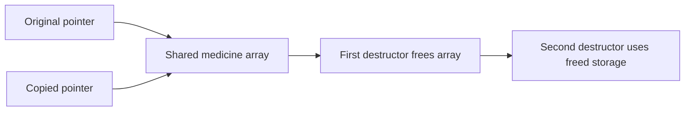
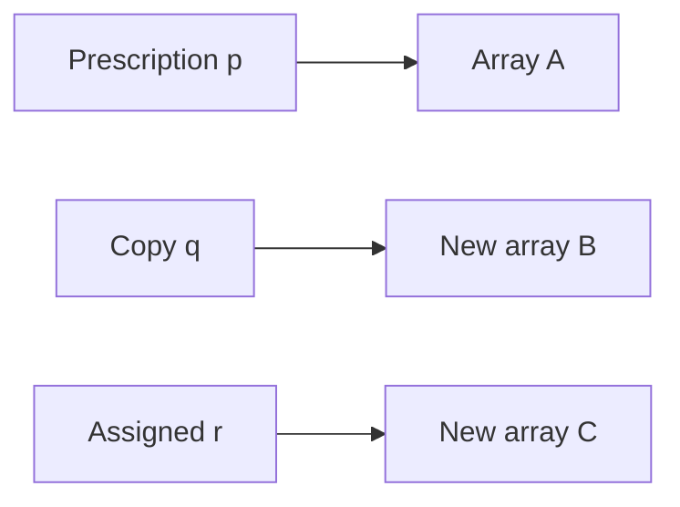

# Q2 Prescription copying and the Rule of Three

## Design and memory diagrams

The unsafe version owns a dynamically allocated string array but has no copy constructor. Compiler-generated copying aliases the pointer. Editing q changes p. When q destroys the shared array, p becomes dangling. The actual ASan diagnostic is heap-use-after-free inside the second destructor while it destroys already-freed string objects. Double ownership is the cause; the saved error is not falsely labelled a reported double-free.

The corrected memory layout is independent:

The corrected copy constructor allocates a fresh array; assignment guards self-assignment, constructs a deep temporary and swaps ownership; the destructor uses delete[]. This is the Rule of Three: destructor, copy constructor and copy assignment must agree on resource ownership. The delegating copy constructor also ensures cleanup if a string assignment throws after the target constructor completes. The hardened class checks counts/indices and supports zero medicines.

complete.cpp preserves the supplied skeleton outside the three TODO replacements, including its original unchecked constructor/set/get. Exception cleanup is included inside the TODO bodies. Its output exactly matches the supplied expected line. without_copy_broken.cpp removes that completed copy constructor while retaining the destructor and copy assignment, and is run separately under ASan as required.

## Copy situations and experiments

Copy construction occurs when initialising from another object, passing a named object by value, or returning an existing object by value when a copy is selected. Return-value copies can be elided; C++17 prvalues have mandatory elision in relevant cases, so returning a value does not guarantee an observable copy call.

Instrumentation observed one copy for a by-value parameter and zero for const reference. Self-assignment, independent edits, assignment independence, negative count, zero size and invalid indices are checked. Five full copies of 10, 1,000 and 100,000 medicines are timed, including allocation/destruction; raw nanosecond totals and checksums are in evidence/normal/main_O0.stdout.txt. These are single local measurements, not universal timings.

## Alternative and evaluation

vector.cpp implements struct Prescription { vector<string> medicines; }; compiler-generated vector/string copies already own independent values, demonstrating the Rule of Zero. Default copying is suitable for value members or intentionally non-owning references, but an owning raw pointer needs explicit ownership rules or a standard RAII container.

For n bounded-length names, both deep-copy solutions require O(n) time and O(n) new storage; more precisely total character count S gives O(n+S). Shallow pointer copying is O(1) time/space but is incorrect for exclusive owning values. Const-reference passing is O(1) and avoids ownership duplication.

Both broken programs are actually rejected with heap-use-after-free. Corrected main, completed skeleton and vector programs pass without address/undefined-behaviour diagnostics. Run python3 scripts/validate.py --task Task02, then repeat with --sanitize. Raw stderr, stdout, exit codes and exact compile commands are retained. Local ASan does not provide leak detection; see Q3.
