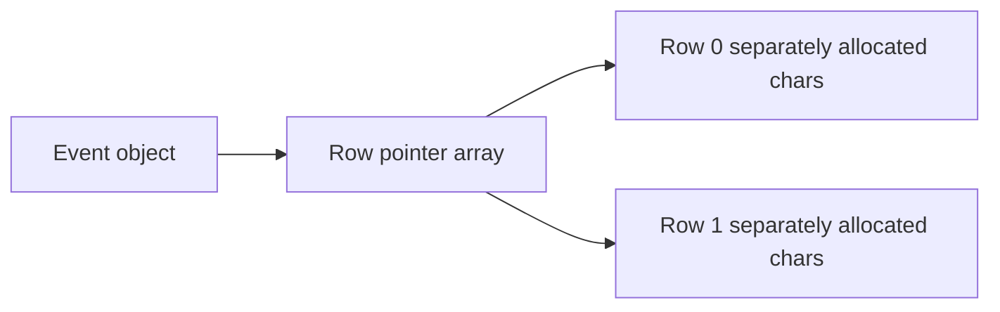

# Q3 Dynamic seat maps and destructors

## Design and ownership

Event allocates a value-initialised array of row pointers with new[], then one char array per row. Constructor failure releases every row already allocated. The destructor deletes each row and the pointer array with delete[], prints the booked-seat count and updates a live-object counter. Copy operations are deleted to prevent accidental ownership duplication. Booking/cancellation validate both indices; duplicate booking and empty cancellation return false.

Stack objects are destroyed on scope exit in reverse construction order. In the experiment the explicit heap delete destroys heap before the block event is destroyed, and the outer stack event is last. A pointer's scope ending does not delete its pointee. In C++17 a destructor has no arguments/return type and cannot be overloaded; it is the class lifetime-ending cleanup operation. Mixing new[] with delete is undefined behaviour, not a reliable way of releasing an array.

## Measurements and experiments

| Rows x seats | Requested row and pointer bytes | Map allocations |
|---|---|---|
| 10 x 20 | 280 | 11 |
| 100 x 200 | 20,800 | 101 |
| 1,000 x 2,000 | 2,008,000 | 1,001 |

Measured sizes use sizeof(char)=1 and sizeof(char*)=8: rows*seats + rows*sizeof(char*). They exclude allocator bookkeeping, resident memory and the Event object's own storage. The code calculates and checks the values. Zero rows is valid with zero allocations; booking a seat in it throws. Negative dimensions, invalid indices and positive rows with zero seats are rejected.

missing_delete.cpp intentionally leaves one live Event and prints live events at exit=1. It was executed under ASan. However this platform does not support LeakSanitizer: -fsanitize=leak is rejected by the compiler, and detect_leaks=1 aborts with the actual message that detect_leaks is not supported on this platform. Both probe logs are retained under evidence/leak_probe. The ordinary ASan run therefore does not report this known leak. A separate successful Linux GitHub Actions run now supplies the missing detector evidence: LeakSanitizer detected the omitted delete, while the corrected Event program exited without leak or address findings. The original timestamped job log is retained as evidence/linux_ci_job.log and the verified run URL/commit are in CI_EVIDENCE.json. The local platform limitation remains documented rather than hidden.

The separate delete_mismatch_broken example is actually rejected by ASan with alloc-dealloc-mismatch when that check is enabled. The corrected Event code has no address/undefined-behaviour findings. RAII ties memory release to scope exit and exception unwinding. Prefer stack Event or unique_ptr<Event> so callers cannot forget deleting the Event object itself.

## Prediction

prediction.txt was committed before Logger was first run. Exact output is +A +B -B copyAc use -Ac +P -P end -A followed by a trailing space and no newline. B is destroyed at block end. Passing named a by value constructs Ac and destroys it after use. new constructs P, delete destroys P, end is printed, then outer A is destroyed. Prediction and execution match. This is assistant-authored, not personal student prediction evidence.

## Alternative and complexity

A flat char* data=new char[rows*seats]{} uses one nonempty allocation and index r*seats+s after dimension/index checks. vector<char> gives that contiguous layout with automatic cleanup. vector<vector<char>> is also RAII, but normally uses an outer allocation plus one allocation per nonempty row and adds per-row vector metadata. All have O(1) indexed access and O(rows*seats) payload/initialisation work. Row pointers add O(rows) storage; the raw destructor releases rows+1 allocations. Prefer flat vector storage in production; the raw version teaches explicit lifetime mechanics.

Run python3 scripts/validate.py --task Task03 and repeat with --sanitize. A successful process exit for the intentional missing-delete fixture is not evidence that its memory management is correct.
