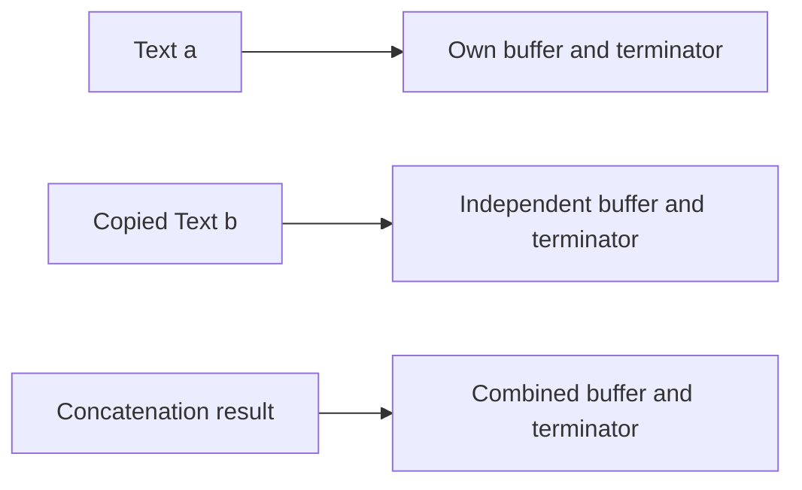

# Q6 Text ownership and the rules of overloading

## Design and memory

Text owns a null-terminated char array plus its length. Constructor, deep-copy constructor, guarded copy assignment and destructor implement the Rule of Three. Copy-and-swap gives transactional assignment and a self-assignment guard avoids unnecessary work. + allocates the combined value, += safely replaces the current value, == compares length/bytes, != negates ==, and << prints text. Size overflow is checked. Tests cover independence, self-assignment, empty/null input and 100,000-character messages.

## Rules

C++17 does not permit overloading ::, ., .*, ?: or sizeof; these retain language-defined name lookup, member access, conditional evaluation and size semantics. New operator symbols cannot be invented. Precedence, associativity and arity cannot be changed. An overloaded operator must involve a class or enum type rather than redefining built-in-only arithmetic. Postfix's dummy int distinguishes a signature without adding a semantic operand.

operator= must be a non-static member controlling replacement of the target's state. +, comparisons and insertion are free friends here for symmetric value operations, stream-left syntax and private representation access. A friend is not a member; friendship is useful when an operation needs internals, otherwise a public accessor API can support a non-friend function.

## Measurements

The copy counter observed zero copies for a+b+c in the ordinary build and two with -fno-elide-constructors. The named result permits optional NRVO, so counts are measured outcomes, not portable guarantees; C++17 mandatory prvalue elision is a distinct case. The executable alternative onCopy(Text a,const Text& b){a+=b;return a;} also records its copies: two in the ordinary -O0 run, three with elision disabled. It reuses the safe += implementation that allocates a combined temporary; copies are not allocation counts.

The 100,000-concatenation benchmark independently combines Hello and World each iteration, consumes lengths and checks 1,000,000 total characters for both Text and std::string. It is not a repeated-growing-string experiment. Both loops call through volatile function pointers to prevent constant-result folding and inlining across the measured join; the shared indirect-call overhead remains part of the measurements. std::string can use small-string storage for these short results, whereas Text allocates a heap buffer. -O0, -O2 and disabled-elision results are saved. All corrected runs pass ASan/UBSan without address errors; leak detection is unavailable locally, as Q3 records.

## Complexity and conclusion

For lengths n1,n2,n3, direct a+b+c copies n1+n2 then n1+n2+n3 characters plus terminators: 2*n1+2*n2+n3+O(1) work, O(n1+n2+n3) time and peak temporary storage. += on a by-value copy may add left-copy/reallocation work but has the same Big-O. std::string may use moves, small-string storage and spare capacity, changing constants. Repeated growing concatenation without capacity reuse can be quadratic; that is a different workload from this benchmark. Equality is O(n) for equal lengths and can return O(1) on unequal lengths. Copy/assignment is O(n), with O(1) self-assignment.

Prefer std::string in production: it supplies tested ownership, moves, capacity and exception behaviour. Writing Text teaches ownership, terminators, exception safety and operator costs. A custom type needs a concrete allocator/representation/protocol requirement; this teaching class is not Unicode/SMS encoding or a binary-string implementation. Run python3 scripts/validate.py --task Task06, optionally with --sanitize.
