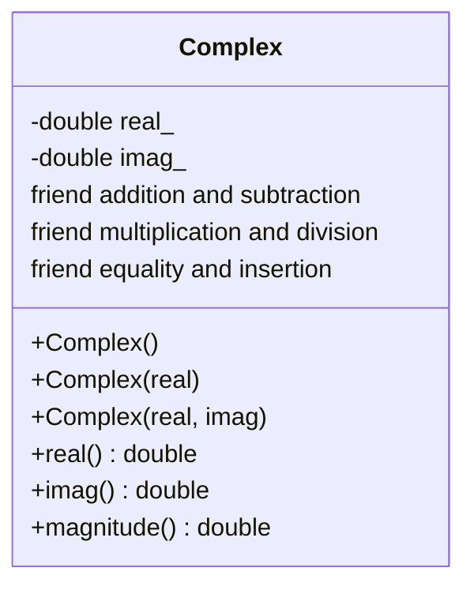

# Q7 Complex impedance design from first principles

## Stage 1 Interpret the problem

Complex stores two private doubles, real and imaginary. The default constructor produces 0+0j, explicit real construction represents a resistor, and a two-argument constructor represents general impedance. Constructors reject nonfinite values. Requirements: arithmetic +,-,*,/, exact ==, rectangular printing, magnitude, and domain_error for exactly zero impedance division. Bounded verification requires component error <=1e-10*(1+maximum component magnitude), checked against std::complex<double>.

## Stage 2 Design and formulas

For a+bi and c+di:

| Operation | Formula |
|---|---|
| + | (a+c)+(b+d)i |
| - | (a-c)+(b-d)i |
| * | (ac-bd)+(ad+bc)i |
| / | ((ac+bd)+(bc-ad)i)/(c*c+d*d), when nonzero |
| magnitude | hypot(a,b) |
| == | Exact equality of both components |

Binary operators are non-member friends for symmetric values/private access. << is non-member for stream-left syntax. Actual division uses a ratio branch to avoid directly squaring the denominator: when abs(c)>=abs(d), r=d/c and denominator=c+d*r; otherwise r=c/d and denominator=d+c*r. This reduces avoidable overflow but does not solve every extreme-double case. Approximate verification is a separate policy from exact ==.

## Stage 3 Implement and verify by hand

Let omega=1,000 rad/s, R=100 ohms, L=0.05 H, C=0.00001 F. Then ZR=100, ZL=50j, ZC=-100j. Series Z=100-50j, magnitude sqrt(12,500)=111.803398875 ohms.

Parallel admittance is 1/100 + 1/(50j) + 1/(-100j) = 0.01-0.01j siemens. Its reciprocal is (0.01+0.01j)/0.0002 = 50+50j ohms, magnitude sqrt(5,000)=70.7106781187 ohms. The implementation applies the pairwise (Z1*Z2)/(Z1+Z2) formula first to R,L then to that result,C. It independently compares against std::complex reciprocal admittance. Both measured answers match the hand results.

Tests cover constructors, singular parallel combination, exact zero division and nonfinite input. A fixed-seed set of 1,000 bounded operand pairs checks four arithmetic operators: 4,000 reference comparisons and zero mismatches. Exact == is used for exact constructor results rather than approximate circuit answers.

## Stage 4 Defend and compare

Each constructor corresponds to an empty value, resistor or general reactance; + serves series circuits; * and / serve parallel circuits; - serves differences; equality, printing and magnitude support inspection. Both the custom type and std::complex<double> measured 16 bytes. Operations use O(1) time and space for fixed-width doubles.

The standard alternative is std::complex<double> with std::abs and explicit application-level zero checks. It supplies mature arithmetic; it does not promise this class's domain_error policy on zero division. Prefer it for production. Remaining limits include intermediate overflow/underflow for extreme finite values, double precision, no near-zero conditioning threshold and no unit types distinguishing ohms, henries and farads. The bounded reference tests are not a proof over all floating values. Run python3 scripts/validate.py --task Task07, optionally with --sanitize.
